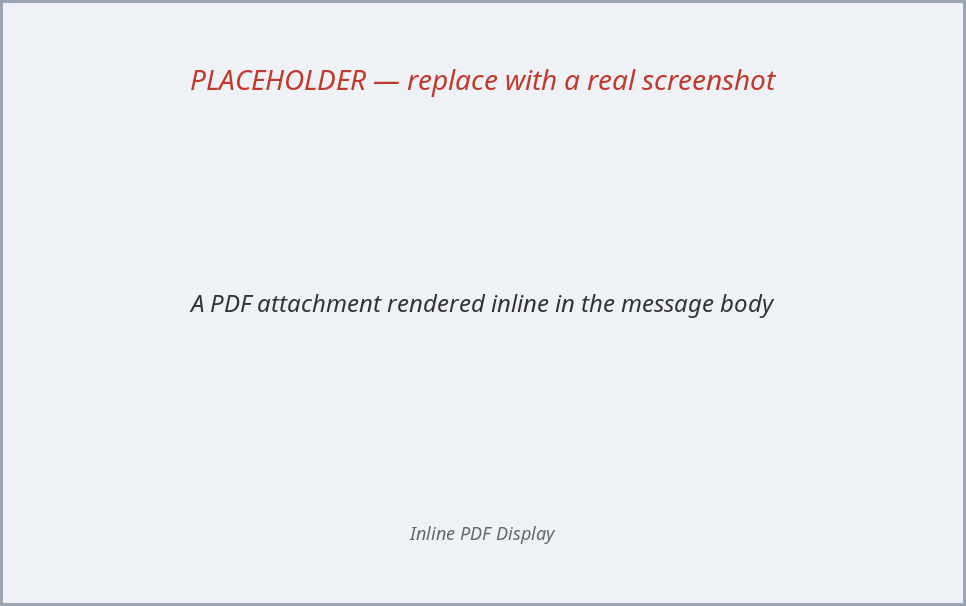
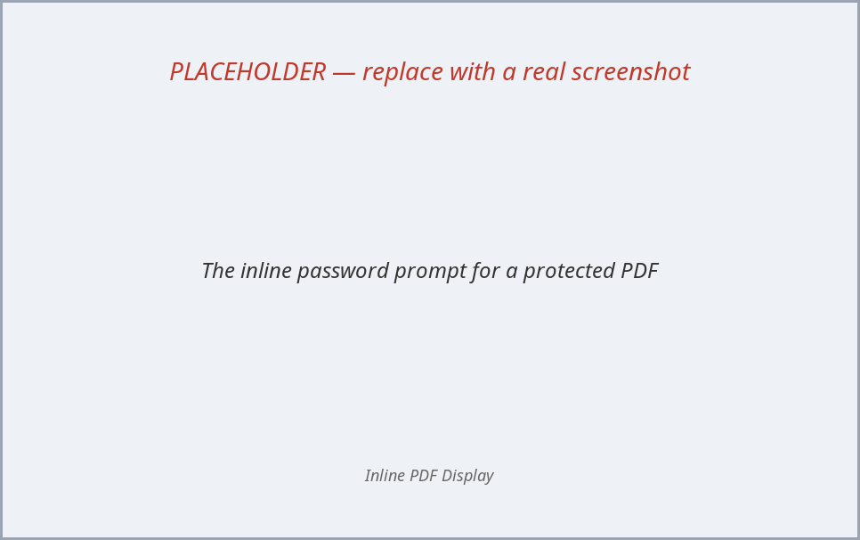
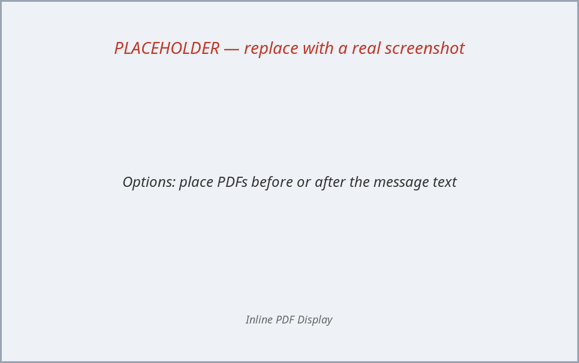

# Inline PDF Display — Thunderbird extension

Renders PDF attachments directly inside the body of an email, so you no longer
have to double-click the attachment to open it in a separate viewer tab.

Built and tested against **Thunderbird 128 ESR and later**.

## Screenshots

> The images below are **placeholders**. To replace them, see
> [Updating the screenshots](#updating-the-screenshots).

| Inline rendering | Password prompt | Options |
|:---:|:---:|:---:|
|  |  |  |

## What it does

- When you open a message that has one or more PDF attachments, each PDF is
  rendered at the **top of the message body** — every page, scrolled inline.
- **Password-protected PDFs:**
  - Files with only an *owner/permissions* password (printing/copying
    restricted, but the file opens freely) display immediately.
  - Files with a *user/open* password (actually encrypted) show an inline
    "🔒 This PDF is password protected" prompt. Type the password and it
    renders in place. (No viewer can show a truly encrypted PDF *without* the
    password — this just handles the prompt gracefully in the body instead of
    failing or popping a separate dialog.)

## How it works

| File | Role |
|------|------|
| `manifest.json` | MailExtension manifest (permissions, script registration) |
| `background.html` | Module background page (lets `background.js` `import` the ESM PDF.js) |
| `background.js` | Loads PDF.js, reads the displayed message's PDF attachments, and **renders each page to a PNG** |
| `content.js` | Runs inside the message body; injects the rendered pages as `` and handles the password prompt |
| `content.css` | Styling for the inline PDF panels |
| `options.html` / `options.js` | Preferences page (PDF placement: before/after the text) |
| `pdfjs/` | Bundled Mozilla PDF.js **6.4.299** (official non-minified `legacy` ESM build; Apache-2.0) |
| `LICENSE` | MIT license for this add-on's code |
| `SUBMISSION.md` / `listing.md` | ATN reviewer notes and store listing copy |

**Architecture / why it's built this way.** The Thunderbird message-display pane
is a heavily sandboxed document, and three "obvious" rendering approaches do NOT
work there (all confirmed by testing in TB 153):

- Running PDF.js **directly in the message content script** crashes with
  `Permission denied to access property "autoAllocateChunkSize"` — the document's
  Xray wrappers break PDF.js's internal streams.
- Embedding an **extension iframe** (`viewer.html`) is blocked by the message CSP
  (the frame silently never loads).
- Painting to a **`<canvas>`** does not work: the `<canvas>` element renders, but
  2D drawing operations (`fillRect`, `drawImage`) from the content-script sandbox
  paint nothing visible.

What *does* work: plain DOM, SVG, and — crucially — **`` with a `data:` URL**.

So the design is: PDF.js runs in the **background page** (a normal same-origin
extension context with no Xray/CSP problems), renders each page to a PNG via an
offscreen canvas, and sends the base64 PNGs to the content script, which inserts
them as `` at the top of the message body.
Password-protected PDFs are detected in the background (PDF.js `PasswordException`)
and prompt inline; the entered password is sent back and the page re-rendered.

## Install (temporary — for testing / development)

Temporary add-ons are removed when Thunderbird restarts; this is the easiest way
to iterate.

1. Thunderbird → **☰ menu → Add-ons and Themes** (or `Tools → Add-ons`).
2. Click the **gear ⚙ icon** → **Debug Add-ons**.
3. Click **Load Temporary Add-on…**
4. Select this folder's `manifest.json`
   (the `manifest.json` in your checkout of this repo).
5. Open an email with a PDF attachment — it renders in the body.

## Install (permanent, from the .xpi)

Thunderbird requires add-ons to be signed by default. For a personal/unsigned
extension you must allow unsigned add-ons:

1. `Tools → Settings → General → Config Editor`
   (or type `about:config` where supported).
2. Set `xpinstall.signatures.required` to **false**.
3. Add-ons gear ⚙ → **Install Add-on From File…** → pick
   `inline-pdf-display.xpi`.

> Note: on some packaged/Flatpak/Snap builds the signature requirement cannot be
> disabled, in which case use the temporary-load method above (re-load after
> each restart).

## REQUIRED after install: "Run on sites with restrictions"

Because this add-on injects a content script into the displayed message,
Thunderbird gates it behind the *quarantined domains* permission, which defaults
to **off**. If PDFs don't render, this is almost always why.

1. **☰ → Add-ons and Themes → Extensions → Inline PDF Display → Manage**
2. Under **Permissions**, set **"Run on sites with restrictions"** to **Allow**.

(The add-on cannot grant this to itself — it is a user-controlled permission.
If you prefer, you can disable quarantining globally in the Config Editor by
setting `extensions.quarantinedDomains.enabled` to `false`, but the per-add-on
toggle above is the recommended, narrower option.)

## Rebuilding the .xpi after edits

```bash
# from the repo root
rm -f inline-pdf-display.xpi
zip -r inline-pdf-display.xpi manifest.json background.html background.js content.js content.css options.html options.js pdfjs icons LICENSE -x '*.map'
```

## Updating the screenshots

The files in `screenshots/` are labeled placeholders. To replace them with real
captures:

1. In Thunderbird, open an email that has a PDF attachment so it renders inline.
2. Capture the areas and save them (overwriting the placeholders), keeping the
   same filenames so the README picks them up automatically:
   - `screenshots/inline-pdf.png` — a PDF rendered in the message body
   - `screenshots/password-prompt.png` — the inline 🔒 password prompt
   - `screenshots/options.png` — the Options page (Add-ons → Inline PDF Display
     → Manage → Options)
3. Tip: use your OS screenshot tool (on GNOME, `gnome-screenshot -a` for an area
     grab). Crop out any private email content before committing.
4. Commit and push: `git add screenshots && git commit -m "Add screenshots" && git push`

These images double as the screenshots for the addons.thunderbird.net listing.

## Troubleshooting

- Nothing shows up: open **Debug Add-ons → Inspect** on this extension to see the
  background console, and check the message-body console for `[InlinePDF]` logs.
- A PDF that is labelled `application/octet-stream` but ends in `.pdf` is still
  picked up (we match on both MIME type and filename).
- Very large PDFs render page-by-page and may take a moment.
